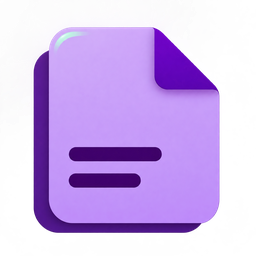
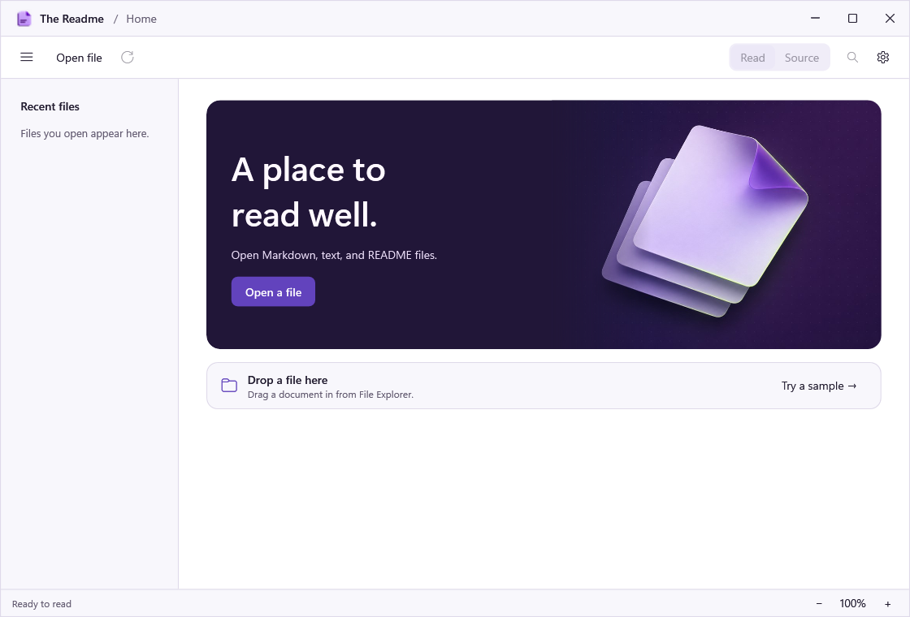
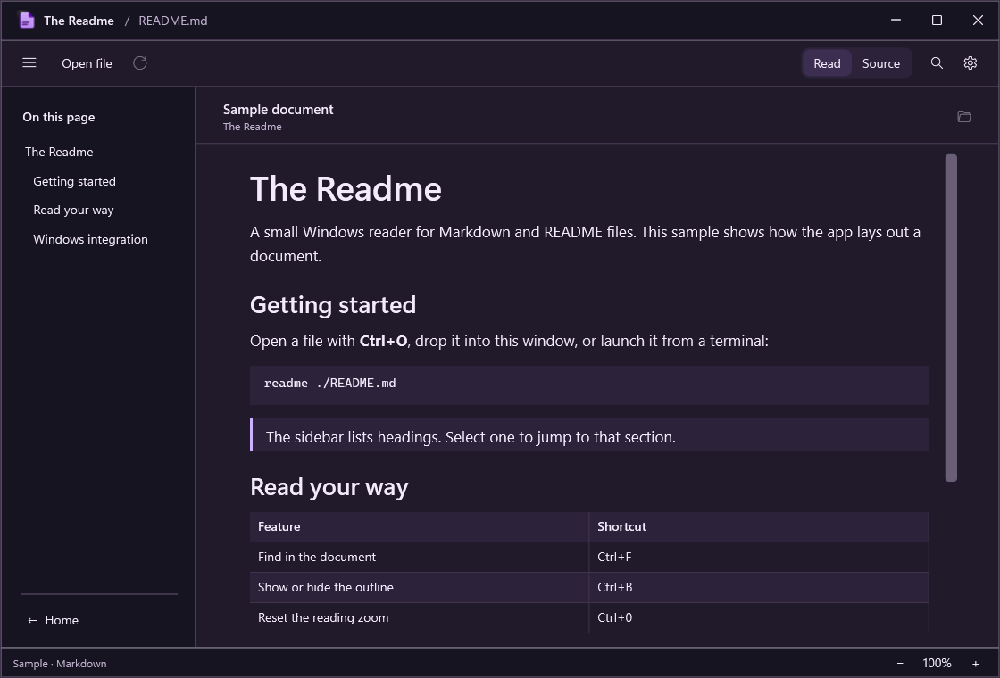

<div align="center">



# The Readme

**A lightweight Markdown and README viewer for Windows.**

[](https://github.com/shardapps/the-readme/actions/workflows/ci.yml)
[](https://github.com/shardapps/the-readme/releases/latest)
[](LICENSE)

[Download for Windows](https://github.com/shardapps/the-readme/releases/latest) · [Installation](#install-on-windows) · [Keyboard shortcuts](#keyboard-shortcuts) · [Contribute](CONTRIBUTING.md)

</div>

The Readme by Shard Apps is a free, open-source desktop app for reading `README.md`, Markdown, plain-text, and extensionless README files on Windows. Open files from Explorer, drop a document into the app, or launch `readme .\README.md` from a terminal. Native Windows rendering keeps the installer small and works offline using the shared .NET Desktop Runtime.



## Read and navigate

- **Read or view source.** Preview headings, lists, tables, task lists, quotes, code blocks, and supported local images. Switch to the original Markdown with **Source**.
- **Find what you need.** Search the current view, jump to a heading from the outline, or reopen a recent file.
- **Make it comfortable.** Choose Lilac, Paper, Moss, Midnight, or the Windows system theme. Adjust zoom or hide the sidebar for a wider reading column.
- **Keep documents local.** The reader requires no sign-in and sends no telemetry. It displays the alt text for remote images and opens external links when activated. [Privacy policy](PRIVACY.md)

| Lilac | Midnight |
| --- | --- |
|  |  |

## Install on Windows

1. Install the official [.NET 10 Windows Desktop Runtime](https://dotnet.microsoft.com/download/dotnet/10.0) for your architecture if you do not already have it.
2. Download the x64 or Arm64 `-setup.exe` from the [latest GitHub release](https://github.com/shardapps/the-readme/releases/latest). In Windows Settings, see **System → About → System type** to check your architecture.
3. Run setup and launch **The Readme** from Start. Setup installs for the current Windows user. Releases include a `SHA256SUMS.txt` file for verifying downloads.

In **Settings → Windows integration**, select **Set as default app** to open Windows Default Apps. Assign the file extensions you want, including `.md` or `.markdown`. Windows manages defaults by file type. Open extensionless files using drag and drop, **Open file**, or the terminal.

To enable the terminal command, select **Add the readme command to my user PATH** during setup or choose **Add to PATH** in the app’s Settings. Open a new terminal window:

```powershell
readme .\README.md
readme ".\project notes.markdown"
readme .\README
```

## Keyboard shortcuts

| Shortcut | Action |
| --- | --- |
| `Ctrl+O` | Open a file |
| `Ctrl+F` | Find in the current view |
| `Enter` / `Shift+Enter` | Next or previous match in the search field |
| `Ctrl+B` | Show or hide the sidebar |
| `Ctrl+,` | Open Settings |
| `F5` | Reload the current file |
| `Ctrl++` / `Ctrl+−` / `Ctrl+0` | Increase, decrease, or reset zoom |

## Supported files and requirements

**Can The Readme open `.md` files on Windows without a browser?** Yes. It is a native Windows desktop Markdown reader. It supports `.md`, `.markdown`, `.mdown`, `.mkd`, `.mkdn`, `.mdwn`, `.mdtxt`, `.txt`, and extensionless text files like `README`, `LICENSE`, and `CHANGELOG`.

**Can I use it as my default Markdown viewer?** Yes. The EXE installer registers The Readme in Windows Default Apps. Choose the file types there.

**Which Windows versions does it target?** Windows 11 x64 and Arm64 are the primary targets. Setup permits Windows 10 22H2 x64 (build 19045) with the matching .NET Desktop Runtime. Files must be UTF-8 or Unicode with a byte-order mark and no larger than 2 MB.

**Can I edit Markdown in the app?** The Readme is a viewer. You can select and copy text from either view. Edit the original in your preferred editor and reload it with `F5`.

## Open source

The Readme uses C#, WPF, .NET 10, and Markdig. See [Contributing](CONTRIBUTING.md) for build and test commands, and [Changelog](CHANGELOG.md) for release history.

[Apache License 2.0](LICENSE) · [Security](SECURITY.md) · [Privacy](PRIVACY.md) · [Code of conduct](CODE_OF_CONDUCT.md) · [Artwork](docs/ARTWORK.md)
