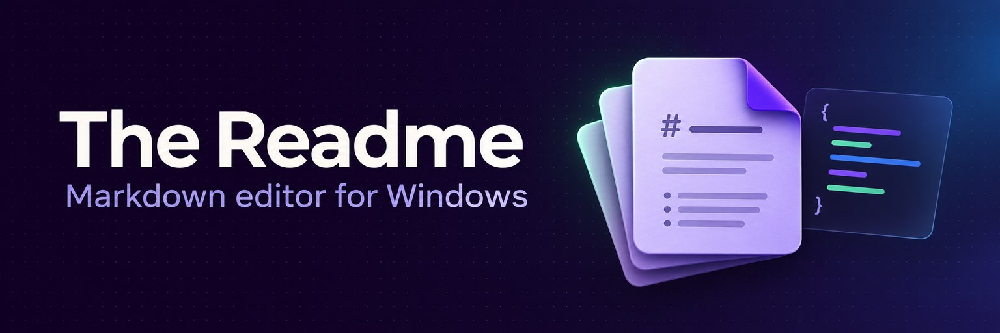
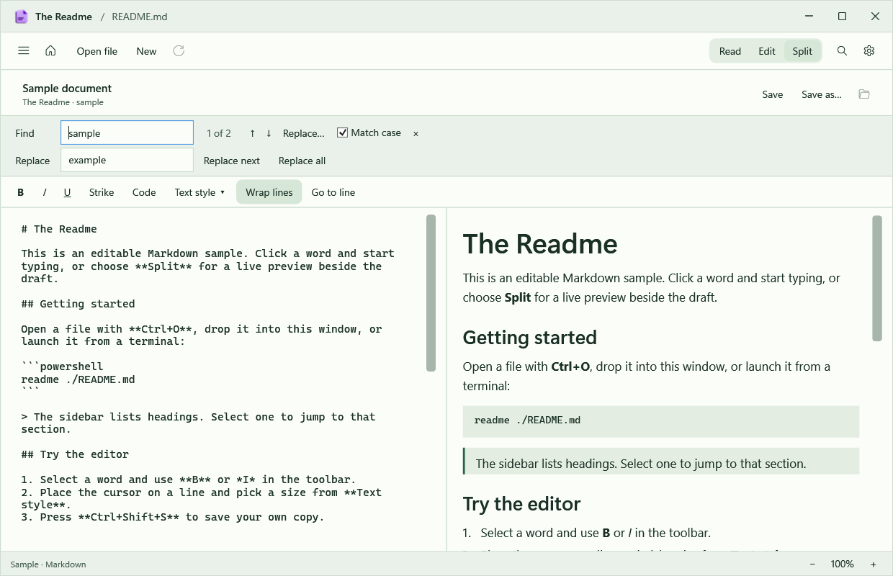
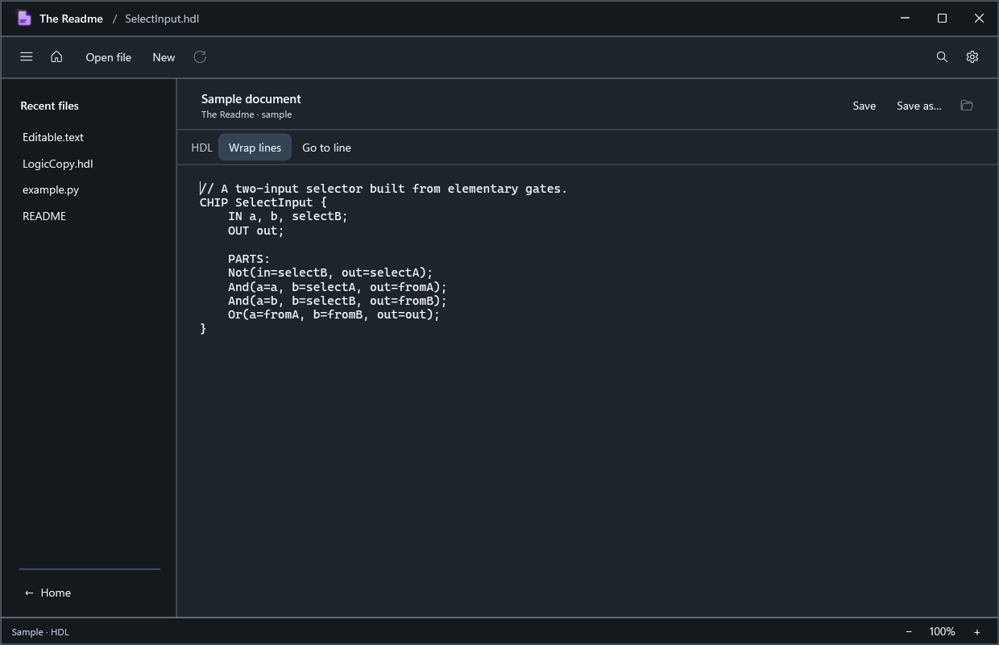

<div align="center">



# The Readme

**A native Windows editor for Markdown, plain text, and source code, with live Markdown preview.**

**~2.6 MB per installer · 134 recognized extensions · 7 themes plus System**

[](https://github.com/shardapps/the-readme/actions/workflows/ci.yml)
[](https://github.com/shardapps/the-readme/releases/latest)
[](LICENSE)

[Browse preview releases](https://github.com/shardapps/the-readme/releases) · [Download stable viewer](https://github.com/shardapps/the-readme/releases/latest) · [See all formats](#supported-file-formats) · [Keyboard shortcuts](#keyboard-shortcuts)

</div>

Source editing, opening preferences, and Find and Replace are available in the updated preview build.

The Readme by Shard Apps is a free, Apache 2.0 desktop app for editing `README.md`, plain text, and source code. Preview Markdown as you type, or work directly in Python, C, C++, Java, HDL, Rust, JavaScript, JSON, CSV, and many other text formats.


## A small download for Windows

The x64 and Arm64 setup EXEs are about **2.6 MB each**. The app uses native Windows Presentation Foundation (WPF) controls and the shared Microsoft .NET 10 Windows Desktop Runtime. Document editing and preview work offline after that runtime is installed. File reads and Markdown parsing run in the background, while the native reading surface adjusts to the space available.

## Write Markdown and plain text

- **Read, Edit, and Split.** Open a README, edit the Markdown source, and see a live preview alongside it. The split view stacks when the usable width gets narrow.
- **Start where you clicked.** Click text in Read view and begin typing to switch to Edit at that position. Settings lets you turn off this behavior and choose Read, Edit, Split, or Last used for newly opened Markdown.
- **Format a selection.** Toggle bold, italic, strikethrough, and inline code. Use **Text style** to switch between title, heading, subheading, and body text. Underline uses the extended Markdown syntax `++text++`, which may display as plain text in other Markdown apps.
- **Save a draft or a copy.** Use **New** to start a Markdown file. Save edits to the original file or use **Save As** to make a copy. The app prompts before leaving unsaved changes and detects a file changed on disk before saving over it.
- **Edit source files.** Open a Python or HDL sample from Home to try editing, searching, wrapping, and going to a line. Source files save as plain text with their original extension. In Settings, you can turn off automatic indentation and transition animations.




## Read and navigate

- **Reflow at your window size.** Text fills the available reading area as you resize, maximize, or hide the outline. Zoom from 60% to 220% with the toolbar, keyboard, or Ctrl+mouse wheel.
- **Find and jump.** Search the current view, replace one or every matching phrase in the editor, or use **Go to line** in source. Toggle the heading or recent files sidebar with Ctrl+B. It starts closed and remembers your choice.
- **Choose a palette.** Select Lilac, Paper, Moss, Ocean, Midnight, Dusk, Graphite, or follow your system theme. Click outside Settings or press Escape to close it.
- **Keep documents local.** The reader requires no sign-in and sends no telemetry. It displays the alt text for remote images and opens external links when activated. [Privacy policy](PRIVACY.md)

| Lilac | Midnight |
| --- | --- |
|  |  |

## Install on Windows

1. Install the official [.NET 10 Windows Desktop Runtime](https://dotnet.microsoft.com/download/dotnet/10.0) for your architecture if you do not already have it.
2. Download the matching x64 or Arm64 setup EXE. In Windows Settings, see **System → About → System type** to check your architecture. [Preview releases](https://github.com/shardapps/the-readme/releases) · [Stable viewer](https://github.com/shardapps/the-readme/releases/latest)
3. Run setup and launch **The Readme** from Start. Setup installs for the current Windows user. The alpha upgrades an existing The Readme installation. Releases include a `SHA256SUMS.txt` file for verifying downloads.

In **Settings → Windows integration**, select **Set as default app** to open Windows Default Apps. Assign the file extensions you want, including `.md`, `.markdown`, or `.hdl`. Windows manages defaults by file type. Open extensionless files using drag and drop, **Open file**, or the terminal.

To enable the terminal command, select **Add the readme command to my user PATH** during setup or choose **Add to PATH** in the app’s Settings. Open a new terminal window:

```powershell
readme .\README.md
readme ".\project notes.markdown"
readme .\README
readme .\src\main.cpp
```

## Keyboard shortcuts

| Shortcut | Action |
| --- | --- |
| `Ctrl+O` | Open a file |
| `Ctrl+N` | New Markdown document |
| `Ctrl+S` / `Ctrl+Shift+S` | Save or Save As |
| `Ctrl+F` | Find in the current view |
| `Ctrl+H` | Find and replace in the editor |
| `Ctrl+1` / `Ctrl+2` / `Ctrl+3` | Switch to Read, Edit, or Split |
| `Alt+Home` | Return to Home |
| `Enter` / `Shift+Enter` | Next or previous match in the search field |
| `Ctrl+G` | Go to a logical source line |
| `Ctrl+B` | Show or hide the sidebar |
| `Ctrl+Shift+B` / `Ctrl+I` | Toggle bold or italic in the Markdown editor |
| `Ctrl+U` | Toggle underline in the Markdown editor |
| `Ctrl+Z` / `Ctrl+Y` | Undo or redo in the editor |
| `Ctrl+,` | Open Settings |
| `F5` | Reload the current file |
| `Ctrl++` / `Ctrl+−` / `Ctrl+0` | Increase, decrease, or reset zoom |
| `Ctrl+mouse wheel` | Zoom in the document workspace |

## Supported file formats

The app recognizes **134 extensions** and **17 common project filenames**. It can also open and edit other valid text files. Supported text files can be up to **2 MiB**. Use UTF-8 or Unicode with a byte-order mark.

| Editable formats | File extensions and names |
| --- | --- |
| Markdown | `.md`, `.markdown`, `.mdown`, `.mkd`, `.mkdn`, `.mdwn`, `.mdtxt` |
| Project documents | `README`, `LICENSE`, `LICENCE`, `CHANGELOG`, `NEWS`, `NOTICE`, `AUTHORS`, `CONTRIBUTING`, `COPYING`, `SECURITY` |
| Plain text | `.txt`, `.text`. Save a Markdown copy to apply formatting. |

The source editor supports undo, search, line wrapping, **Go to line**, and optional auto-indent. It handles programming languages, hardware description languages, shell scripts, HTML and stylesheets, data and configuration files, logs, patches, and build files.

<details>
<summary>Show every recognized source, data, and configuration format</summary>

| Format family | File extensions and names |
| --- | --- |
| Python | `.py`, `.pyw`, `.pyi` |
| C | `.c`, `.h` |
| C++ | `.cpp`, `.cc`, `.cxx`, `.hpp`, `.hh`, `.hxx`, `.ipp`, `.inl`, `.ixx` |
| Java | `.java` |
| C# | `.cs`, `.csx` |
| JavaScript | `.js`, `.jsx`, `.mjs`, `.cjs` |
| TypeScript | `.ts`, `.tsx`, `.mts`, `.cts` |
| Rust | `.rs` |
| Go | `.go` |
| Swift | `.swift` |
| Kotlin | `.kt`, `.kts` |
| Ruby | `.rb`, `.rake`, `Gemfile`, `Rakefile` |
| PHP | `.php`, `.phtml` |
| Lua | `.lua` |
| R | `.r` |
| Dart | `.dart` |
| Scala | `.scala`, `.sc` |
| F# | `.fs`, `.fsx`, `.fsi` |
| Visual Basic | `.vb`, `.vbs` |
| Objective-C | `.m`, `.mm` |
| Assembly | `.asm`, `.s`, `.inc` |
| Haskell | `.hs`, `.lhs` |
| Elixir | `.ex`, `.exs` |
| Zig | `.zig` |
| Shell | `.sh`, `.bash`, `.zsh`, `.fish`, `.bashrc`, `.zshrc` |
| PowerShell | `.ps1`, `.psm1`, `.psd1` |
| Batch | `.bat`, `.cmd` |
| HDL | `.hdl` |
| Verilog | `.v`, `.vh`, `.sv`, `.svh` |
| VHDL | `.vhd`, `.vhdl` |
| SQL | `.sql` |
| HTML | `.html`, `.htm`, `.xhtml` |
| Stylesheet | `.css`, `.scss`, `.sass`, `.less` |
| XML | `.xml`, `.xaml`, `.svg`, `.plist`, `.csproj`, `.vbproj`, `.fsproj`, `.props`, `.targets`, `.resx`, `.slnx` |
| JSON | `.json`, `.jsonc`, `.jsonl`, `.geojson`, `.ipynb` |
| YAML | `.yaml`, `.yml` |
| TOML | `.toml` |
| Configuration | `.ini`, `.cfg`, `.conf`, `.editorconfig`, `.gitignore`, `.gitattributes`, `.dockerignore`, `.env`, `.lock` |
| Delimited text | `.csv`, `.tsv`, `.psv` |
| Log | `.log`, `.out` |
| Diff | `.diff`, `.patch` |
| Text markup | `.rst`, `.adoc`, `.asciidoc`, `.org`, `.tex`, `.typ` |
| Build file | `Dockerfile`, `Containerfile`, `Makefile`, `GNUmakefile`, `CMakeLists.txt`, `.mk`, `.cmake`, `.gradle`, `.sln` |

</details>

| HDL | Python |
| --- | --- |
|  |  |

**What does Split do in the Markdown editor?** It shows your draft and a live rendered preview together. Bold, italic, headings, code blocks, tables, and task lists are available as Markdown syntax. The toolbar offers shortcuts for common styles.

**Can I use it as my default Markdown viewer?** Yes. The EXE installer registers The Readme in Windows Default Apps. Choose the file types there.

**Can I edit code files without running them?** Yes. Code, scripts, HTML, and configuration open as plain source text. Markdown formatting controls appear only for Markdown documents.

**Which Windows versions does it support?** Windows 11 x64 and Arm64 are the primary targets. Setup permits Windows 10 22H2 x64 (build 19045) with the matching .NET Desktop Runtime.

## Open source

The Readme uses C#, WPF, .NET 10, and Markdig. See [Contributing](CONTRIBUTING.md) for build and test commands, and [Changelog](CHANGELOG.md) for release history.

[Apache License 2.0](LICENSE) · [Security](SECURITY.md) · [Privacy](PRIVACY.md) · [Code of conduct](CODE_OF_CONDUCT.md) · [Artwork](docs/ARTWORK.md)
