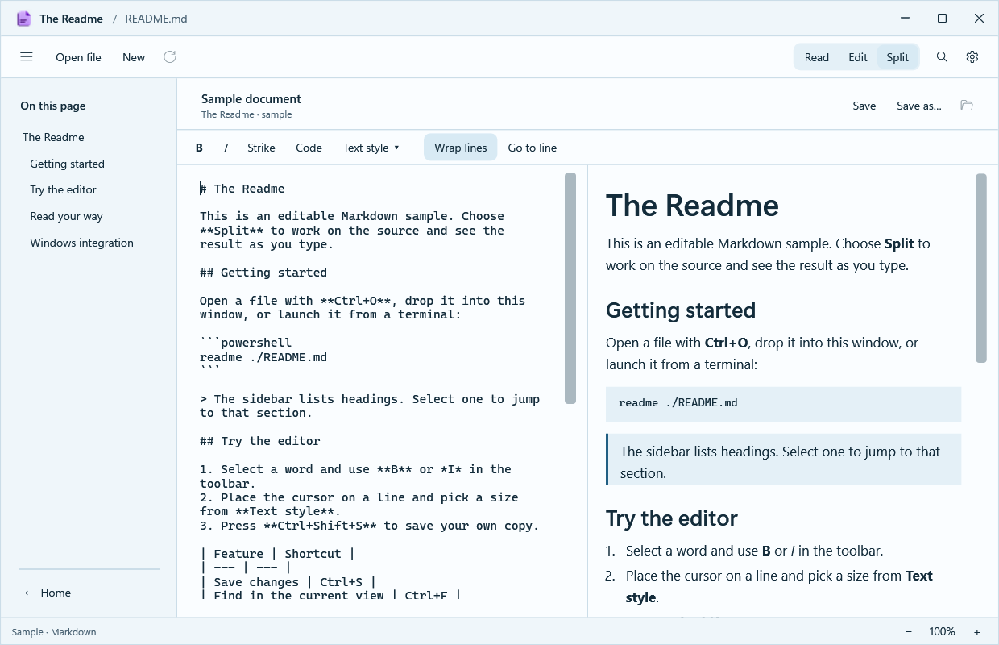
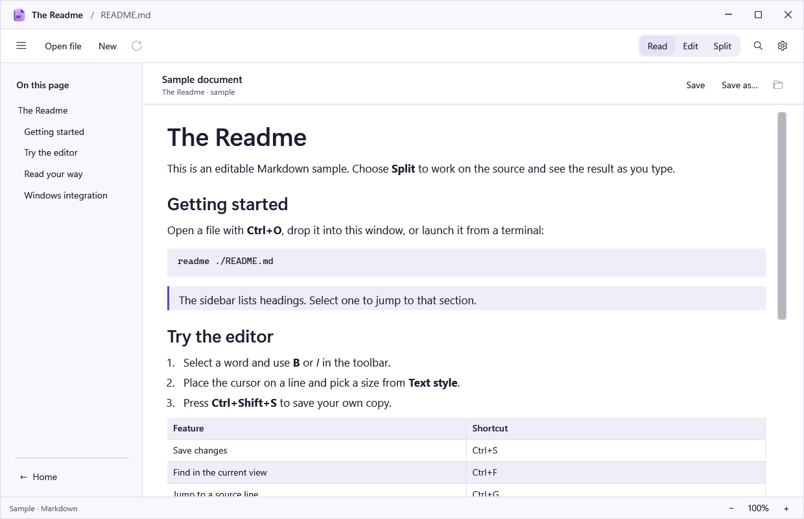
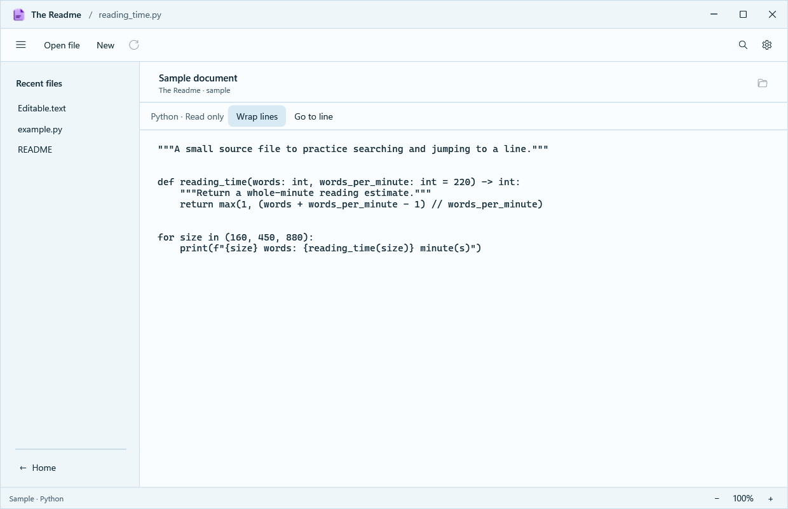

<div align="center">


# The Readme

**A lightweight Markdown editor and source-file viewer for Windows.**

[](https://github.com/shardapps/the-readme/actions/workflows/ci.yml)
[](https://github.com/shardapps/the-readme/releases/latest)
[](LICENSE)

[Download editor alpha](https://github.com/shardapps/the-readme/releases/tag/v1.1.0-alpha.1) · [Download stable viewer](https://github.com/shardapps/the-readme/releases/latest) · [Keyboard shortcuts](#keyboard-shortcuts) · [Contribute](CONTRIBUTING.md)

</div>

The Readme by Shard Apps is a free, open-source Windows app for writing Markdown and plain text and reading source files. Use it as a README editor, a local Markdown previewer, or a quick way to inspect Python, C, C++, Java, HDL, and other code files. The native desktop app works offline using the shared .NET Desktop Runtime.


## Write Markdown and plain text

- **Read, Edit, and Split.** Open a README, edit the Markdown source, and see a live preview alongside it. The split view stacks when the usable width gets narrow.
- **Format a selection.** Toggle bold, italic, strikethrough, and inline code. Use **Text style** to switch between title, heading, subheading, and body text. These styles are saved as standard Markdown.
- **Save a draft or a copy.** Use **New** to start a Markdown file. Use **Save as** to save as Markdown or plain text. The app prompts before leaving unsaved changes and detects a file changed on disk before saving over it.
- **Practice on a sample.** Open the editable README from Home or try the Python example to practice searching, wrapping lines, and jumping to a line.



## Read and navigate

- **Reflow at your window size.** Text fills the available reading area as you resize, maximize, or hide the outline. Zoom from 60% to 220% with the toolbar, keyboard, or Ctrl+mouse wheel.
- **Find and jump.** Search the current view, jump to a heading from the Markdown outline, use **Go to line** in source, or reopen a recent file.
- **Choose a palette.** Select Lilac, Paper, Moss, Ocean, Midnight, Dusk, Graphite, or follow your system theme. Click outside Settings or press Escape to close it.
- **Keep documents local.** The reader requires no sign-in and sends no telemetry. It displays the alt text for remote images and opens external links when activated. [Privacy policy](PRIVACY.md)

| Lilac | Midnight |
| --- | --- |
|  |  |

## Install on Windows

1. Install the official [.NET 10 Windows Desktop Runtime](https://dotnet.microsoft.com/download/dotnet/10.0) for your architecture if you do not already have it.
2. Download the matching x64 or Arm64 setup EXE. In Windows Settings, see **System → About → System type** to check your architecture. [Editor alpha](https://github.com/shardapps/the-readme/releases/tag/v1.1.0-alpha.1) · [Stable viewer](https://github.com/shardapps/the-readme/releases/latest)
3. Run setup and launch **The Readme** from Start. Setup installs for the current Windows user. The alpha upgrades an existing The Readme installation. Releases include a `SHA256SUMS.txt` file for verifying downloads.

In **Settings → Windows integration**, select **Set as default app** to open Windows Default Apps. Assign the file extensions you want, including `.md` or `.markdown`. Windows manages defaults by file type. Open extensionless files using drag and drop, **Open file**, or the terminal.

To enable the terminal command, select **Add the readme command to my user PATH** during setup or choose **Add to PATH** in the app’s Settings. Open a new terminal window:

```powershell
readme .\README.md
readme ".\project notes.markdown"
readme .\README
readme .\src\main.cpp
```

## Keyboard shortcuts

| Shortcut | Action |
| --- | --- |
| `Ctrl+O` | Open a file |
| `Ctrl+N` | New Markdown document |
| `Ctrl+S` / `Ctrl+Shift+S` | Save or Save As |
| `Ctrl+F` | Find in the current view |
| `Enter` / `Shift+Enter` | Next or previous match in the search field |
| `Ctrl+G` | Go to a logical source line |
| `Ctrl+B` | Show or hide the sidebar |
| `Ctrl+Shift+B` / `Ctrl+I` | Toggle bold or italic in the Markdown editor |
| `Ctrl+Z` / `Ctrl+Y` | Undo or redo in the editor |
| `Ctrl+,` | Open Settings |
| `F5` | Reload the current file |
| `Ctrl++` / `Ctrl+−` / `Ctrl+0` | Increase, decrease, or reset zoom |
| `Ctrl+mouse wheel` | Zoom in the document workspace |

## Supported files and requirements

| Files | What you can do |
| --- | --- |
| Markdown `.md`, `.markdown`, `.mdown`, `.mkd`, `.mkdn`, `.mdwn`, `.mdtxt` and project documents named `README`, `LICENSE`, or `CHANGELOG` | Read, edit, format, and save |
| Plain text `.txt` and `.text` | Edit and save as plain text, or use Save As to create a Markdown copy for formatting |
| Source files `.py`, `.c`, `.h`, `.cpp`, `.hpp`, `.java`, `.cs`, `.js`, `.ts`, `.rs`, `.go`, `.swift`, `.kt`, `.rb`, `.php`, `.hdl`, `.sv`, `.vhdl`, and more | Read, search, copy, wrap lines, and go to a line |
| Scripts, build files, web source, data, and configuration | Read-only inspection of files such as `Makefile`, `Dockerfile`, `.sh`, `.ps1`, `.html`, `.svg`, `.json`, `.csv`, `.yaml`, `.toml`, `.xml`, and `.log` |
| Other text files | Read-only view when the file can be decoded as text |



**What does Split do in the Markdown editor?** It shows your draft and a live rendered preview together. Bold, italic, headings, code blocks, tables, and task lists are available as Markdown syntax. The toolbar offers shortcuts for common styles.

**Can I use it as my default Markdown viewer?** Yes. The EXE installer registers The Readme in Windows Default Apps. Choose the file types there.

**Can I open code files without running them?** Yes. Code, scripts, HTML, and configuration open as inert text. Source formats stay read-only, so the format and save controls are reserved for Markdown and plain text.

**Which Windows versions and encodings does it support?** Windows 11 x64 and Arm64 are the primary targets. Setup permits Windows 10 22H2 x64 (build 19045) with the matching .NET Desktop Runtime. Files use UTF-8 or Unicode with a byte-order mark and are limited to 2 MB for opening and saving.

## Open source

The Readme uses C#, WPF, .NET 10, and Markdig. See [Contributing](CONTRIBUTING.md) for build and test commands, and [Changelog](CHANGELOG.md) for release history.

[Apache License 2.0](LICENSE) · [Security](SECURITY.md) · [Privacy](PRIVACY.md) · [Code of conduct](CODE_OF_CONDUCT.md) · [Artwork](docs/ARTWORK.md)
